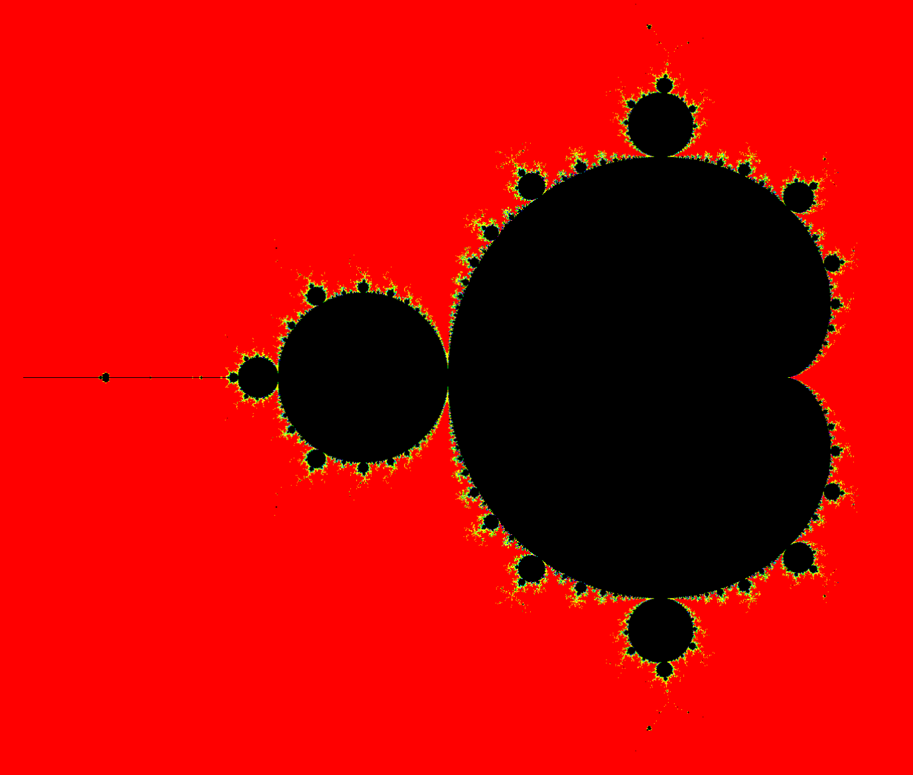

# mandelbrot
A server for generating and hosting mandelbrot set tiles

## Host it yourself
Just run the mandelbrot server with docker (see the [docker-compose.yml](./docker-compose.yml)) file or build it yourself using `cargo build --release` and configure the environment variables, including the connection to the redis server.

### Redis
This software uses redis as cache for the tiles. It's currently not possible to run it without redis. I recommend using valkey instead of redis, it's compatible and open source. 

## How to use?
Just open the url of the mandelbrot in your webbrowser.

## Environment variables
- `REDIS_URL`: Url to connect to redis (*redis://localhost* is the default value)
- `PIXELS_PER_TILE`: Configure how many pixels should be displayed per row/column per tile (*255* is the default value)
- `LISTEN_ADDRESS`: Configure where the mandelbrot server should listen (*127.0.0.1:8000* is the default value, *0.0.0.0:80* is the default value in docker)
- `MAX_PREGENERATE_ZOOM_LEVEL`: Configure the max zoom level that should be pregenerated
